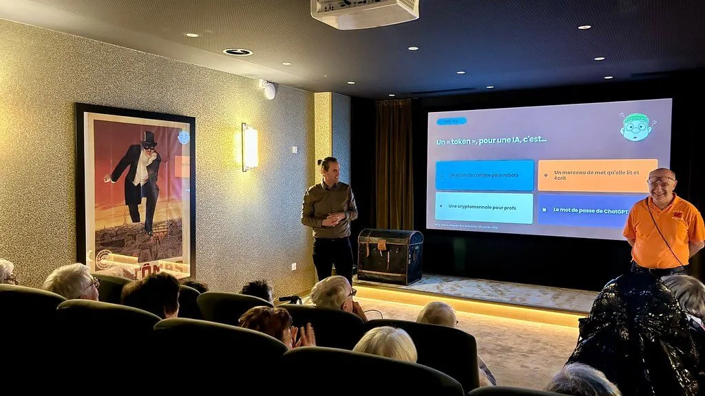
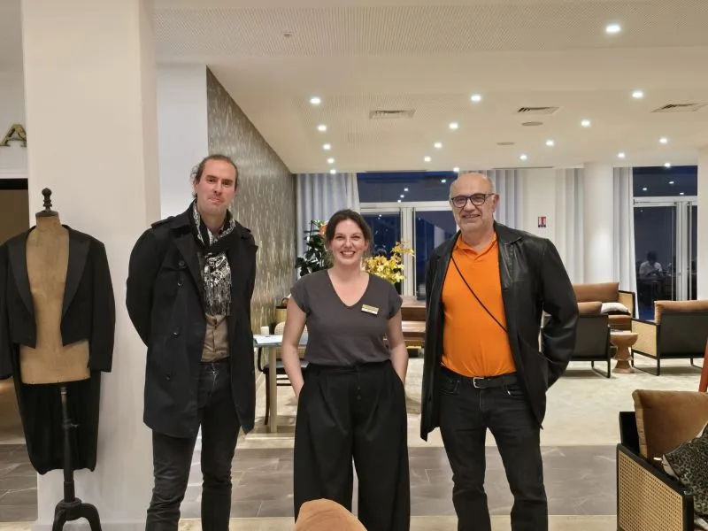

Le *jeudi 22 octobre 2026*, la https://www.residences-montana.com/fr/vos-montana/montana-dijon[résidence seniors Montana], à Dijon, a accueilli une conférence d'introduction à l'intelligence artificielle. Au micro, deux intervenants : Alexis Martinot, de https://www.linkedin.com/company/actiabfc/home/[*ACT.IA-BFC*], et Michel Girard, du https://diiage.cucdb.fr/[CUCDB] et membre du Developers Group Dijon.

== Une conférence pour comprendre l'IA

La résidence, qui accueille des seniors autonomes, souhaitait proposer à ses résidentes et résidents une présentation simple et concrète : qu'est-ce que l'IA, d'où vient-elle, quel est son impact dans le quotidien, bénéfique comme néfaste, et à quoi faire attention quand on l'utilise.

C'est ce que les deux intervenants ont présenté, en s'appuyant notamment sur un quiz pour rendre le sujet vivant.

== Une mission de l'association

Cette intervention fait partie des missions du Developers Group Dijon : collaborer avec les autres associations de notre région, et vulgariser l'informatique auprès du grand public.

Merci à ACT.IA-BFC pour cette collaboration, et à la résidence Montana pour son accueil.

Le post LinkedIn d'ACT.IA-BFC sur cette conférence est à retrouver ici : link:https://lnkd.in/p/eBMM3x-b[Voir le post LinkedIn,role=button]
