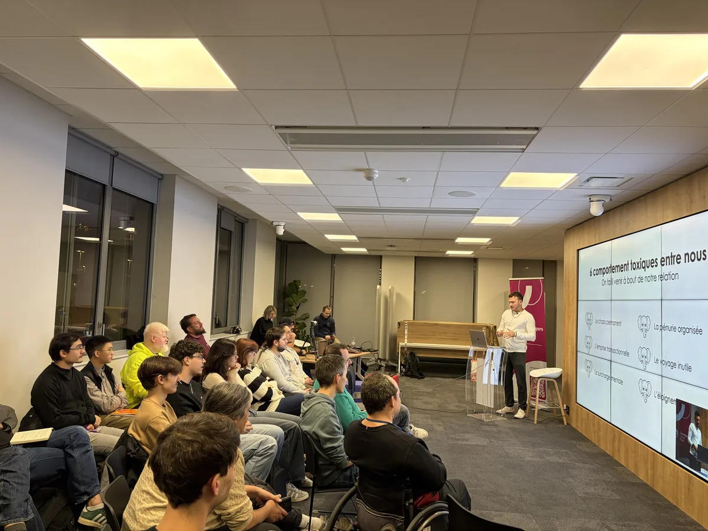
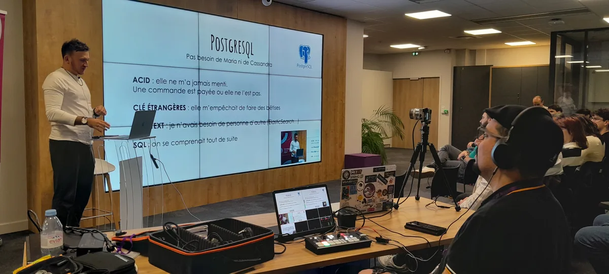
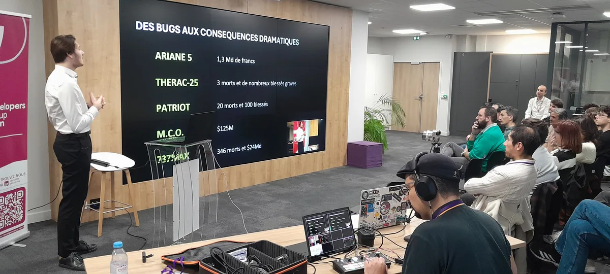
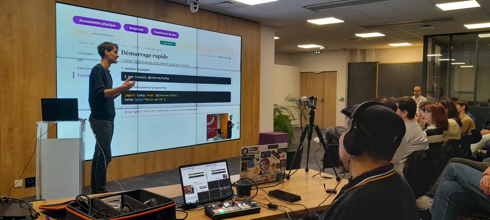
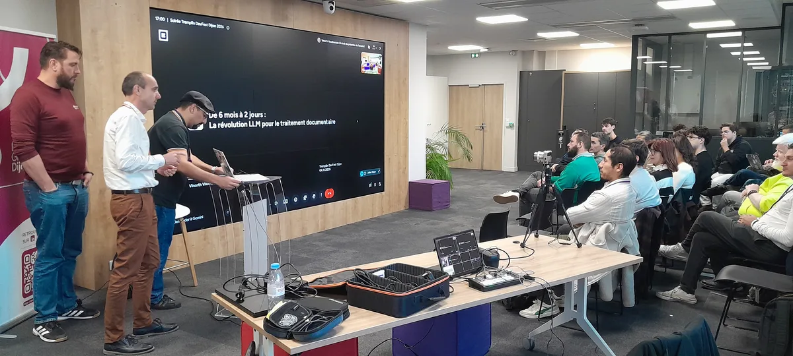

Le https://www.developers-group-dijon.fr/tremplin-devfest-2026/[Tremplin du DevFest 2026] a eu lieu le 4 novembre, comme annoncé. Quatre speakers sont montés sur scène pour présenter leur talk, et à l'issue de la soirée, deux d'entre eux ont été sélectionnés.

== Les deux talks sélectionnés

* *Relation toxique avec sa base de données : 6 comportements à éviter*, par Léo Jacquemin
* *Rendre l'implicite explicite*, par Thomas Hodson

Bravo à eux !

Ces deux talks seront présentés au DevFest Dijon 2026, le vendredi 4 décembre. Les places sont ouvertes : rendez-vous sur le https://devfest.developers-group-dijon.fr/[site du DevFest Dijon] pour vous inscrire.

== Merci !

Merci aux quatre speakers d'avoir joué le jeu de cette première scène. Merci aussi aux coachs, qui les ont accompagnés dans la préparation de leur talk, et à https://craftsrecords.org/[Crafts Records], qui a porté ce coaching.

Merci enfin à https://www.bpce-si.fr/[BPCE-SI] pour son accueil.

